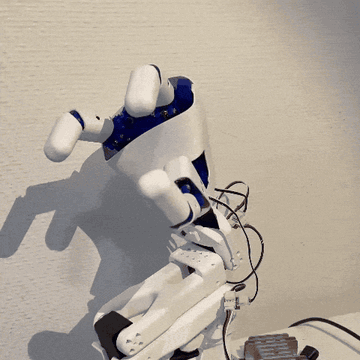

# LaMain

An open, low-cost three-finger hand for the SO-101 arm, designed to stay under 200 g and
under 200 EUR.

<p align="center">
  
</p>

## Why

Tactile data is scarce, and most hands able to produce it are expensive or closed, while
learning-based manipulation needs many cheap and comparable devices to collect that
data. LaMain is meant to be one of them, a 3D-printed hand that mounts on an SO-101 arm
and runs on hobby servos.

## How it works

Five Feetech STS3036 servos drive `index_flex`, `middle_flex`, `abduction`, `thumb_rot`
and `thumb_flex` through rigid linkages. Their geometry and joint limits live in
`hand_model.yaml`, which is the single source of truth for the control code, the
calibration and the URDF that will be generated from it.

Every command passes a safety filter that checks joint range, step size and torque
before it reaches the bus. Calibration records joint limits from the hand posed by hand
at released torque, and gestures and episodes are stored as plain JSON files.

```bash
lamain calibrate      # record joint limits
lamain studio         # jog, record gestures and episodes
lamain inspect        # per-joint diagnostic sweep
```

Tests run on a simulated bus with a fake clock, so the whole pipeline works without
hardware.

## Status

| | |
|---|---|
| Hardware | revision A, five STS3036 servos, SO-101 mount |
| Software | bus, calibration, safety filter, controller, studio, episodes |
| Tests | full suite on `FakeBus`, run in CI |
| Tactile sensing | planned |
| LeRobot plugin | planned |
| Dataset and benchmark | planned |

## Quickstart

```bash
uv sync                 # install the workspace and dependencies
uv run lamain --help    # CLI overview
uv run pytest           # tests on FakeBus, no hardware
```

## Repository layout

```
lamain/
├── packages/lamain-core/   # library, bus, model, calibration, safety, controller
├── packages/lamain-cli/    # the `lamain` CLI
├── hands/LM-0001/          # per-hand build manifest and calibration files
├── demos/                  # gestures and episodes
├── docs/                   # roadmap and decision records
└── tests/                  # FakeBus tests, run in CI
```

## Hardware

The bill of materials is in a [shared spreadsheet](https://docs.google.com/spreadsheets/d/1QRkrFNEr4OLIYoRjOxhvR7IqRy3qPOLTq45OjTfyoFY/edit?usp=sharing).
CAD rev A is not published yet. The earlier SCS0009 design is kept at the `scs0009-final`
tag, and the switch to the STS3036 is recorded in
[D-006](docs/decisions/D-006-servo-sts3036.md).

## Planned

The tactile fingertip pad and the policy integration come first, followed by a URDF
generator, a LeRobot plugin and a reproducible benchmark against the stock gripper. The
open bench tests are listed in [docs/ROADMAP.md](docs/ROADMAP.md).

## License

Software is released under Apache-2.0, see [LICENSE](LICENSE). The hardware licence is
still pending, see [D-003](docs/decisions/D-003-licences.md).

## Credits

Arthur Mourgue and Julien Navet designed the CAD. The project is inspired by Pollen
Robotics' [AmazingHand](https://github.com/pollen-robotics/AmazingHand).
